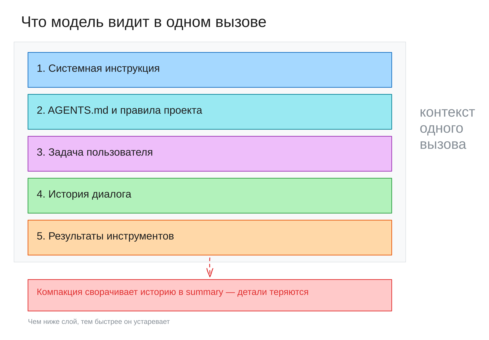
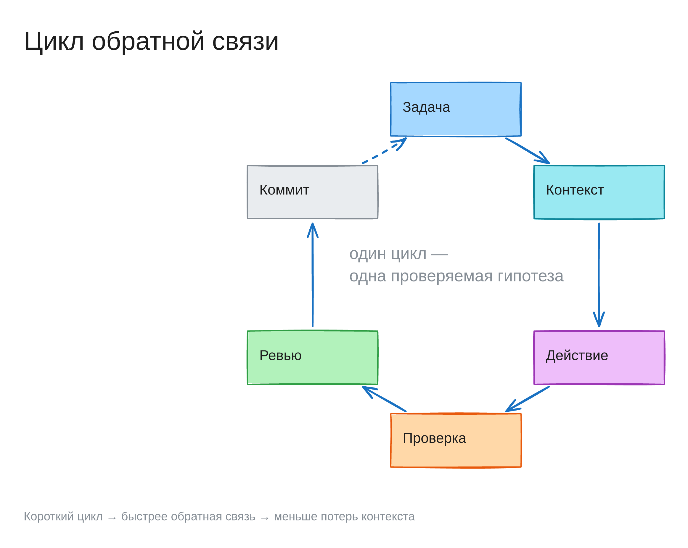
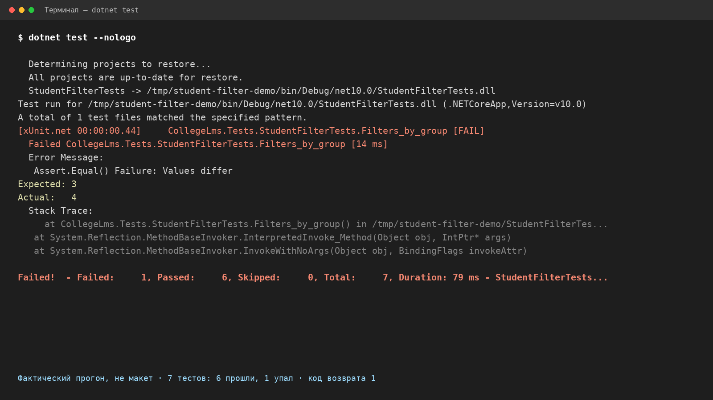

# Неделя 2. Контекст и feedback loop

Минимальный контекст-пакет и цикл проверок, замкнутый на командах проекта

<!-- notes: 1 мин. Назвать неделю и навыки маршрута: 3 — контекст и инструкции, 4 — feedback loop. Спросить: кто на прошлой неделе получил от агента «готово», которое не проверялось. Ответы не разбирать, вернуться к ним на слайде 12. На доске — две колонки: «контекст» и «проверка». -->

---

## План лекции

- Релевантность контекста важнее объёма — Меньше, но точнее: что модель видит в одном вызове.
- AGENTS.md и знания проекта — Правила, команды и границы — в файлах, а не в голове.
- Состояние между сессиями — История временна, файлы постоянны: решения и журнал.
- Feedback loop и порядок проверок — От дешёвых проверок к дорогим, цикл замыкается командой.
- Как читать вывод команд — Код возврата, первая ошибка, полный лог.
- Типичные ошибки и разобранный пример — Пять ошибок, которые обесценивают проверку.

<!-- notes: 2 мин. Озвучить логику порядка: сначала что агент видит, потом что он делает и как это подтверждается. Сказать, что артефакт недели складывается из двух частей: контекст-пакет — слайды 3–6, журнал проверок — слайды 13–18. Вопрос аудитории: что из списка уже делали руками. -->

---

## Контекст — минимум, без которого задача не решается

- Постановка из недели 1
- 3–7 файлов, которые участвуют в изменении
- Спека или user story
- Ограничения проекта
- Команды проверки
- Список неизвестностей

<!-- notes: 5 мин. Продиктовать шесть пунктов и сразу отсечь лишнее: всё остальное — шум, даже если файл «тоже про студентов». Спросить: сколько файлов в прошлой задаче открывал агент и сколько из них были реально нужны. Записать на доске формулу «контекст = постановка + файлы + правила + проверка». -->

---

## Пять слоёв контекста



<!-- notes: 4 мин. Показать на схеме пять слоёв сверху вниз: системная инструкция, AGENTS.md и правила проекта, задача пользователя, история диалога, результаты инструментов. Главный смысл: чем ниже слой, тем быстрее он устаревает — системная инструкция постоянна, а результаты инструментов живут до следующего вызова. Отдельно про историю: при компакции она сворачивается в summary, точные детали теряются, поэтому договорённости выносят в файлы. Спросить: какой слой студент контролирует сам. Ответ: задачу и файлы проекта, остальное задаёт harness. -->

---

## «Прочитать весь репозиторий» — плохая стратегия

- Окно контекста конечно, а полный проект дороже
- Внимание размывается: похожие файлы путают
- Мёртвый код и старые спеки агент читает как руководство

<!-- notes: 5 мин. Разобрать три причины по очереди. Пример: три похожих класса Student в разных слоях и устаревшая спека — модель цитирует не тот файл и не считает это ошибкой. Спросить: чем архив отличается от актуального кода с точки зрения агента. Ответ: ничем, пока это не записано. -->

---

## Сначала карта и указатели, потом правки

- Карта: где backend, frontend, спеки, тесты
- Указатели: логика — файл, тест — файл, спека — путь
- Неверная карта — потеря времени, неверный указатель — не тот файл

<!-- notes: 5 мин. Показать на репозитории CollegeLMS: карта — четыре-пять строк, по строке на зону, указатель — конкретный путь. Подчеркнуть диагностику: ошибка в карте видна по долгому поиску, ошибка в указателе — по первому же ответу агента. Вопрос: что дешевле исправить — карту или указатель. -->

---

## Полноту контекст-пакета проверяют до правок

- Попросить перечислить файлы к изменению
- Попросить команды, которыми будет проверять
- Список расходится — контекст неполный или постановка размыта
- Пять минут сверки экономят час переделки

<!-- notes: 5 мин. Это приём, который студенты пропускают чаще всего. Проговорить вслух запрос: «перечисли файлы и команды проверки, правок пока не делай». Спросить: что делать, если агент не может назвать файл. Ответ: он будет искать наугад. Дать 1 минуту — сформулировать такой запрос для своей задачи недели 1. -->

---

## AGENTS.md — инструкция агенту, а не документация

- Документация объясняет, как устроен проект и почему
- AGENTS.md говорит, что делать и чего не делать
- Команды проверки, политика веток, границы согласования
- Короткая карта репозитория с указателями на подробности

<!-- notes: 5 мин. Открыть в IDE глобальный AGENTS.md и AGENTS.md проекта: два слоя, разный охват. Спросить: какое правило из проекта агент нарушил бы, если бы файла не было. Подчеркнуть: документация для человека, инструкция для агента — разные жанры. -->

---

## Команды из AGENTS.md копируются в терминал дословно

- Команды дословно, без пересказа
- Порядок: ветка до правки, проверки до merge, merge до push
- Запреты: миграции, `.env`, `docker-compose.yml`, workflow
- Карта: backend, frontend, тесты, спеки, дизайн-система
- Без пересказа архитектуры на десять экранов

<!-- notes: 6 мин. Показать AGENTS.md CollegeLMS и предложить скопировать оттуда одну команду в терминал — дословность проверяется практикой. Спросить: почему запрет на миграции важнее описания слоёв. Ответ: до конца энциклопедии агент не дочитает. На доске — четыре элемента: команды, порядок, запреты, карта. -->

---

## Пробел в AGENTS.md фиксируют, но правку согласуют

- Дважды объяснили одну команду — пробел в инструкции
- Агент полез в прод-каталог — граница не записана
- На этой неделе: формулировка и обоснование в `results.md`
- Правку AGENTS.md принимает автор проекта

<!-- notes: 4 мин. Показать формат записи: «сейчас — так, предлагаю — так, потому что — это». Отдельно проговорить границу недели: пробелы находим и записываем, файл не правим. Вопрос: почему нельзя молча дописать правило в AGENTS.md. Ответ: инструкция — часть проекта, а не личный черновик. -->

---

## Сессия не помнит предыдущую — помнят файлы

- История сессии живёт только до её конца
- Постоянное: AGENTS.md, спека, план, `results.md`
- `results.md`: что сделано, каким способом, что вышло, что осталось

<!-- notes: 5 мин. Провести аналогию: блокнот на столе против памяти собеседника. Спросить: что из прошлой сессии пришлось объяснять заново. Записать на доске: «история — временно, файл — постоянно». Связать с артефактом недели: журнал проверок живёт в results.md. -->

---

## Компакция сохраняет смысл, но теряет детали

- Harness сворачивает старые сообщения в summary
- Теряются имена полей, номера строк, критерии, ссылки
- Решения записывать сразу, а не надеяться на память
- На неделе 4 — `.memory-bank/`: index, product, architecture, decisions

<!-- notes: 5 мин. Показать, как выглядит summary после компакции: общий смысл есть, точных значений нет. Спросить: что из вчерашней договорённости агент воспроизведёт через час. Ответ: только то, что в файле. Подчеркнуть: memory-bank — та же идея, но на уровне репозитория. -->

---

## Feedback loop замыкается на командах, а не на заверениях

- Цикл: сделал → проверил → прочитал → исправил
- Без цикла агент не знает, компилируется ли код
- Человек проверяет не «написал ли», а «какой командой подтверждено»
- Команда не запускалась — результата нет, есть только текст

<!-- notes: 6 мин. Вернуться к ответам со слайда 1: «готово» без команды — это текст. Нарисовать на доске четыре шага цикла и подписать, кто их делает. Спросить: сколько итераций цикла нужно, чтобы починить упавший тест. Ответ: столько, сколько нужно до зелёного прогона, а не одна. -->

---

## Цикл обратной связи



<!-- notes: 3 мин. Показать шесть шагов: задача → контекст → действие → проверка → ревью → коммит. Подчеркнуть: цикл замыкается коммитом и новой задачей, а не «готово» в чате. Один цикл — одна проверяемая гипотеза; чем короче цикл, тем быстрее обратная связь. -->

---

## Проверки идут от дешёвых к дорогим

build → формат → таргетные тесты → frontend → гейты → E2E

```bash
dotnet build CollegeLMS.slnx
dotnet csharpier check .
dotnet test CollegeLMS.slnx --filter FullyQualifiedName~{Name}
(cd CollegeLMS.Next && npm run build)
(cd CollegeLMS.Next && npm run check:design-system)
(cd CollegeLMS.Next && npx playwright test {spec})
```

<!-- notes: 6 мин. Сказать, что порядок и скобки у cd разобраны на неделе 1 (слайд 11); здесь важно место проверок в цикле: каждая итерация начинается с build и заканчивается таргетными тестами, а E2E — только по необходимости. Команды — только из AGENTS.md CollegeLMS, не из памяти. Скобки у cd — подоболочка, блок копируется целиком. Упал build — E2E не запускаем: ошибка всё равно раньше. Полный прогон тестов — в CI, локально только затронутые. Спросить: сколько минут экономит правильный порядок при падении сборки. Попросить записать порядок как личный чек-лист перед сдачей практики. -->

---

## Playwright допустим только на изолированном стенде

- Worktree изолирует файлы, а не сервер и базу
- `localhost:3000` и `reuseExistingServer` ведут на общий стенд
- Нужны свой `PLAYWRIGHT_BASE_URL` и одноразовая база
- Иначе в журнале: «не запускался: нет изолированного стенда»

<!-- notes: 5 мин. Разобрать риск: спек подключился к общему стенду или к проду и изменил данные. Спросить: чем «не запускался» лучше, чем «вроде прошло». Ответ: честный результат проверки вместо ложного зелёного. Подчеркнуть, что это не молчаливый пропуск, а запись в журнале. -->

---

## Код возврата — не истина

- Ноль — успех, ненулевой — ошибка, но этого мало
- Первая ошибка — причина, остальные — следствия
- Полный лог в файл, а не пересказ хвоста
- Ложное зелёное: код 0, а проверено не то
- Фильтр без совпадений, кэш, пропуск, не тот спек, скрытая ошибка
- В журнал — что именно проверялось

<!-- notes: 6 мин. Три вещи при чтении вывода: код возврата, первая ошибка, полный лог. Спросить: почему разбор начинают с первой ошибки, а не с последней строки. Дать определение с экрана: ложное зелёное — код 0, когда проверили не то. Перечислить все пять видов из лекции §5 и спросить, какой встречался им. Показать на экране хвост лога и полный лог. Вывод: «зелёный» — это «проверено то, что нужно, и совпало с ожиданием». -->

---

## Упавший тест: смотреть на первую ошибку



<!-- notes: 4 мин. Показать реальный прогон, не макет: код возврата 1, строка [FAIL], Expected 3 / Actual 4, итог Failed 1 — Passed 6 — Total 7. Спросить: какой тест не выполнил ожидание и где это видно; почему «красный» — не приговор, а адрес первой ошибки. Связать с §5: сначала код возврата, затем первая ошибка, затем полный лог. -->

---

## Пять ошибок, которые обесценивают проверку

- Проверять не то: frontend build при правке backend
- Игнорировать формат: csharpier падает, а правят логику
- Чинить тест вместо кода — потеря проверки
- Гонять E2E на каждую правку текста
- Работать в прод-каталоге: там контейнеры и пользователи

<!-- notes: 7 мин. Самый полезный слайд для практики — разобрать каждую ошибку на примере. По «чинить тест вместо кода»: сначала выяснить, что тест проверяет; чаще неверен код. Спросить: какая из пяти ошибок дешевле всего исправляется привычкой. Ответ — проверка соответствует изменению. Попросить каждого выбрать свою самую вероятную ошибку и записать её в results.md. -->

---

## Зелёный build: код 0 и ни одной ошибки

Ожидаемый вывод; сборка в этой итерации не запускалась

```text
$ dotnet build CollegeLMS.slnx
...
Build succeeded.
    0 Warning(s)
    0 Error(s)
```

<!-- notes: 5 мин. Сверить с прогоном студентов и записать отличия. Показать, как выглядит красный build: код возврата ненулевой, первая ошибка — первая строка с `error CS…`. Вопрос: что делаем сразу после красного build. Ответ: читаем первую ошибку, E2E не запускаем. -->

---

## Зелёный прогон — это выбранные и выполненные тесты

В журнал: cwd, фактическая команда, число тестов, код возврата, первая ошибка, путь к логу

```text
$ dotnet test CollegeLMS.slnx --filter FullyQualifiedName~StudentFilterTests
Passed!  - Failed:     0, Passed:     7, Skipped:     0, Total:     7
```

<!-- notes: 4 мин. Сравнить с неудачным фильтром: тот же прогон с опечаткой в имени даёт «No test matches the given testcase filter» и код 1 — прогон не состоялся, тестов не выбрано. Спросить: может ли запись «0 тестов, код 0» считаться зелёной. Ответ: нет, проверка не состоялась — как в лекции §5. Показать `results.md`: таблицу журнала проверок и заполненную строку. Проговорить состав записи полностью: `cwd`, фактическая команда без плейсхолдеров, сколько тестов выбрано и выполнено, код возврата, первая ошибка с классификацией, путь к полному логу. Для E2E без стенда — «не запускался: нет изолированного стенда»; `N/A` — только для неприменимой проверки, с причиной. -->

---

## Резюме: что запомнить

- Контекст — минимум релевантного, а не весь репозиторий
- Сначала карта и указатели, потом правки
- AGENTS.md — команды, порядок, запреты, карта
- Память — это файлы, а не история чата
- Цикл замыкается на команде, а не на слове «готово»
- Зелёный результат подтверждается логом и числом тестов

<!-- notes: 2 мин. Проговорить шесть выводов и связать с артефактом недели: разделы «Контекст-пакет», «Журнал проверок», «Пробелы AGENTS.md» в results.md. Показать эти три раздела на экране. Спросить: какой пункт сегодня был новым. Записать на доске, что сдаётся к следующему занятию. -->

---

## Вопросы для самопроверки

- Почему «прочитай весь репозиторий» ухудшает результат?
- Чем AGENTS.md отличается от документации проекта?
- Что теряется при компакции и как это компенсировать?
- Почему проверки идут от дешёвых к дорогим?
- Какой прогон считается зелёным, а какой — ложным зелёным?
- Как отличить ошибку кода от ошибки проверки?

<!-- notes: 2 мин. Дать 30 секунд на первый вопрос в парах, затем разобрать вслух. Шесть вопросов совпадают с self-check.md по порядку — полные ответы там. Вопрос про E2E сознательно вынесен на слайд 14: здесь оставляем классификацию ошибки, она нужна в шаге 4 практики. Оставить вопросы на экране при разборе и напомнить: журнал проверок заполняется по ходу практики, а не после. -->
